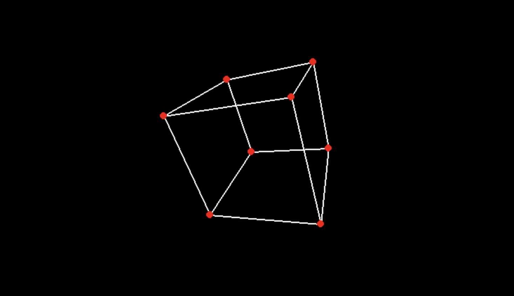

# 3D Cube Renderer — CMU 21-241

A simple 3D cube renderer built in Python for **Carnegie Mellon University's 21-241: Matrices and Linear Transformations** course.

This project demonstrates how linear algebra can be used to transform and project 3D objects onto a 2D screen. It uses NumPy for matrix operations and Pygame for rendering, implementing 3D rotations, scaling, camera movement, and perspective projection.

## Features

- 3D cube rendering using vertices and edges
- Rotation around the X, Y, and Z axes
- Camera movement and orientation controls
- Cube scaling
- Perspective projection using homogeneous coordinates
- Matrix-based transformations implemented with NumPy

## Preview



## Installation

Requires Python 3 and the following libraries:

```bash
pip install numpy pygame
```

Run the project:

```bash
python main.py
```

## Controls

- W/S: Move camera forward / backward
- A/D: Move camera left / right
- Q/E: Move camera up / down
- Arrow Keys: Adjust camera pitch and yaw
- X: Toggle X-axis rotation
- Y: Toggle Y-axis rotation
- Z: Toggle Z-axis rotation
- R/T: Scale cube up / down
- ESC: Exit

## How It Works

The cube is represented by eight vertices in homogeneous coordinates and twelve connecting edges.

Each vertex passes through a series of matrix transformations:

1. Model transformation: Rotates the cube around its axes.
2. View transformation: Positions and orients the camera.
3. Perspective projection: Converts 3D coordinates into projected coordinates.
4. Viewport transformation: Maps the projected coordinates onto the 800×600 Pygame window.

The final vertices and edges are drawn using Pygame, without relying on a dedicated 3D rendering engine.

## Technologies

- Python: Language of Choice
- NumPy: Matrix operations and linear algebra
- Pygame: Window management, input handling, and 2D rendering
